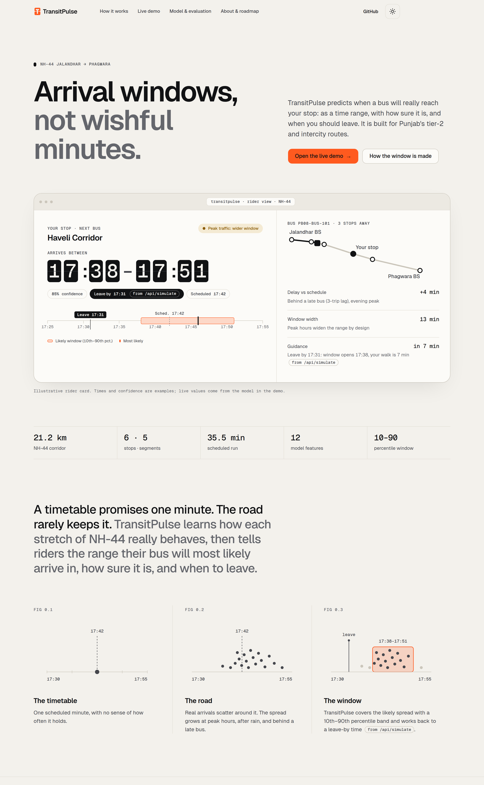

# TransitPulse



Honest arrival windows for Punjab's tier-2 and intercity buses. TransitPulse predicts delay on one corridor, NH-44 from Jalandhar to Phagwara, and shows a likely arrival plus a leave-by time. That range is this stop's 10th–90th delay band shifted by earlier stops' estimated delays, not a calibrated cumulative interval. The training table is synthetic GPS from `notebooks/01_phase1_data_pipeline.ipynb` (NumPy seed 42). Held-out scores describe that table. They are not real-world accuracy.

The service is FastAPI (`src/app.py`). It serves the site in `web/` and the JSON API. Models in `models/` are loaded at startup and are not retrained on boot.

## Pages

| Path | What it shows |
| --- | --- |
| `/` | Rider card: selected bus, stop, status, leave-by, and a likely arrival. Presets are Midday clear, Morning rush and rain, and Severe congestion, with the same walk as `/demo`. Links under the presets open the corridor controls and the evaluator |
| `/how-it-works` | Five steps from a GPS ping to rider guidance, with an explorer for fields, cleaning, features, the interval formula, and status rules |
| `/demo` | Same scenario model, with sliders for hour, weather, upstream lag, speed, dwell, and walk (0–30 min). `?view=evaluator` opens the diagnostics tab. The page can download the current scenario or the evidence table as CSV, and print the evaluator brief. If `/api/*` cannot be reached, the page uses a labelled in-browser stand-in |
| `/model` | Held-out metrics, feature importance, validation design, caveats, and the hashed artifact inventory |
| `/about` | Why the corridor matters, a roadmap, and the builder |

Unknown page paths return `web/404.html` with status 404. Unknown `/api/*` paths return `{"detail": "Not Found"}` with status 404.

## API

| Method | Path | Role |
| --- | --- | --- |
| `GET` | `/api/health` | `{"status": "ok", "service": "TransitPulse AI", ...}` after the models load |
| `GET` | `/api/corridor` | Six stops, five segments, 21.2 km, 35.5 scheduled minutes, bus `PB08-BUS-101` |
| `POST` | `/api/simulate` | Inference for every segment. `walk_time_min` defaults to 5 (allowed 0–30). Each segment's `leave_by_min` is the cumulative scheduled arrival plus predicted delay through that stop, minus the walk |
| `GET` | `/api/evidence` | Metrics, interval coverage, the GPS-speed and upstream-lag ablations, and artifact hashes |
| `GET` | `/api/diagnostics` | Model metadata, the data-quality audit, plots, and runtime status |

Public status follows the point delay: under 2.0 min is On-Time, 2.0–6.0 min is Moderate Delay, above 6.0 min is Severe Delay.

Peak hours (`src/peak.py`): weekdays 08:00–10:00 and 17:00–19:00; weekends 16:00–19:00. Hours are inclusive.

Stops, in order: Jalandhar Bus Stand, PAP Chowk, Rama Mandi, Haveli Corridor, LPU Main Gate, Phagwara Bus Stand.

## Model

Frozen scikit-learn 1.9.1 artifacts, `random_state=42`. Training days are 1–24 (3,750 rows). The untouched test window is days 25–30 (945 rows).

| Artifact | Estimator |
| --- | --- |
| `models/delay_regressor.joblib` | `RandomForestRegressor`, 100 trees, `max_depth=12` |
| `models/delay_classifier.joblib` | `RandomForestClassifier`, 100 trees, `max_depth=10` |
| `models/quantile_lower_10.joblib` | `GradientBoostingRegressor`, quantile α 0.10 |
| `models/quantile_upper_90.joblib` | `GradientBoostingRegressor`, quantile α 0.90 |

Held-out regressor metrics in `models/model_metadata.json`: MAE 0.627 min, RMSE 0.914 min, R² 0.945. The historical-average baseline MAE is 3.498 min (82.07% lower error). Classifier accuracy is 0.891 and macro F1 is 0.893.

The published interval is centred on the point delay. Half-width is `max(0.6, (upper − lower) / 2)`, multiplied by 1.35 at peak, and the lower bound is floored at −1.0 minute. Mean raw interval width is 1.095 min off-peak and 3.491 min at peak. On the 945 test rows, 0.8698 of actual delays fall inside that published interval (0.8916 of 332 peak rows, 0.8581 of 613 off-peak rows).

`src/ablation.py` retrains only the regressor with the same split and seed. Dropping `gps_speed_kmh` records MAE 0.819 min and R² 0.903. Dropping `rolling_3trip_delay_min` records MAE 0.738 min and R² 0.926 in `models/ablation.json` under `lag_ablation` (days 1–24 / 25–30, seed 42, 100 trees, depth 12, `n_jobs` 1). The shipped regressor is not replaced. The 10th–90th band is not an 80% or 85% coverage guarantee. Observed coverage is the separate held-out figure above.

Cleaning (`models/dq_audit_report.json`): 4,800 raw pings, 57 outside the corridor box, 48 outside 2–95 km/h, 48 dwell values imputed, 0 duplicate trip/segment rows, 4,695 clean rows (97.81% kept).

Twelve features: `hour_of_day`, `day_of_week`, `is_weekend`, `is_peak_hour`, `segment_id`, `segment_distance_km`, `scheduled_time_min`, `historical_segment_avg_min`, `rolling_3trip_delay_min`, `prev_stop_dwell_sec`, `weather_severity`, `gps_speed_kmh`.

## Run locally

Python 3.11 (`.python-version` is `3.11.18`).

```bash
python3.11 -m venv .venv
source .venv/bin/activate
pip install -r requirements.txt
HOST=127.0.0.1 PORT=8000 python -m src.app
```

The same app object is what Render starts:

```bash
uvicorn src.app:app --host 0.0.0.0 --port 8000
```

Open `http://127.0.0.1:8000`. The simulator is `http://127.0.0.1:8000/demo`. Evaluator view: `http://127.0.0.1:8000/demo?view=evaluator`.

`HOST` and `PORT` default to `0.0.0.0` and `8000` when you run `python -m src.app`. Notebook 01 also needs seaborn:

```bash
pip install -r requirements-notebooks.txt
```

On Windows, `.\run.ps1` installs `requirements.txt` if imports fail and starts uvicorn. It runs `src/export_artifacts.py` only when `models/dq_audit_report.json` is missing.

## Tests

```bash
pip install -r requirements-dev.txt
python -m pytest -q
```

`tests/test_smoke.py` loads the frozen models and checks health, corridor, diagnostics, simulate (including leave-by, walk-time validation, and that the severe-congestion inputs raise delay versus midday), evidence hashes against the files on disk, the five pages, the HTML 404, and the JSON `/api` 404.

## CSS bundles

Edit `web/css/tokens.css`, `web/css/chrome.css`, `web/css/site.css`, `web/css/demo-bridge.css`, `web/styles.css`, or `web/vendor/fonts/fonts.css`, then regenerate:

```bash
python scripts/bundle_web_css.py
python scripts/bundle_web_css.py --check
```

`--check` exits 1 if `web/css/site.bundle.css` or `web/css/demo.bundle.css` does not match the sources. CI runs that check.

## Deploy to Render

`render.yaml` is a Blueprint for one free web service.

1. Sign in at [dashboard.render.com](https://dashboard.render.com).
2. Click **New**, then **Blueprint**.
3. Connect the GitHub repo and select branch **main**.
4. Confirm the service: Python `PYTHON_VERSION` **3.11.18**, plan **Free**, build `pip install -r requirements.txt`, start `uvicorn src.app:app --host 0.0.0.0 --port $PORT`, health check `/api/health`.
5. Click **Apply**. Do not add a database or a second service. Leave `PORT` unset.

A free web service sleeps after 15 minutes with no traffic. The next request is a cold start of about 30–60 seconds, then `/api/health` answers. One always-on instance fits inside the free 750 hours per month.

### Keep-alive

`.github/workflows/keepalive.yml` pings `$TRANSITPULSE_URL/api/health` every 10 minutes (`*/10 * * * *`) and on **Run workflow**. The URL is the Actions variable `TRANSITPULSE_URL` (for example `https://<service>.onrender.com`).

Set it under **Settings → Secrets and variables → Actions → Variables**. If the variable is unset, the workflow prints a notice and exits 0.

`curl` retries 3 times, 20 seconds apart, with a 90 second limit, so a cold start can finish. The job allows 5 minutes, reads only repository contents, and uses one concurrency group so pings do not overlap.

GitHub may start a scheduled run later than the cron time. On a public repository, scheduled workflows are disabled after 60 days with no repository activity.

## Credit

Utkarsh Kumar, Lovely Professional University, course CSE276.

## Project structure

```text
TransitPulse/
├── .github/workflows/
│   ├── ci.yml                 Install, CSS bundle check, pytest
│   └── keepalive.yml          Ping /api/health on a schedule
├── assets/                    Plots and logo SVGs
├── data/
│   ├── raw/                   Synthetic GPS telemetry
│   └── processed/             Clean model table
├── models/                    Frozen joblib files, metadata, ablation, audit
├── notebooks/                 Phase 1 generator and phase 2 training
├── scripts/bundle_web_css.py
├── src/
│   ├── app.py                 API, pages, inference
│   ├── peak.py                Shared peak-hour rule
│   ├── ablation.py            GPS-speed and upstream-lag ablations, plus interval coverage
│   └── export_artifacts.py    Train or verify artifacts and the phase 2 plot
├── tests/test_smoke.py
├── web/                       Five pages, demo, 404, CSS, JS, vendored fonts and Leaflet
├── render.yaml
├── requirements.txt           Pinned runtime dependencies
├── requirements-dev.txt       pytest and httpx
├── requirements-notebooks.txt seaborn for notebook 01
└── run.ps1
```
