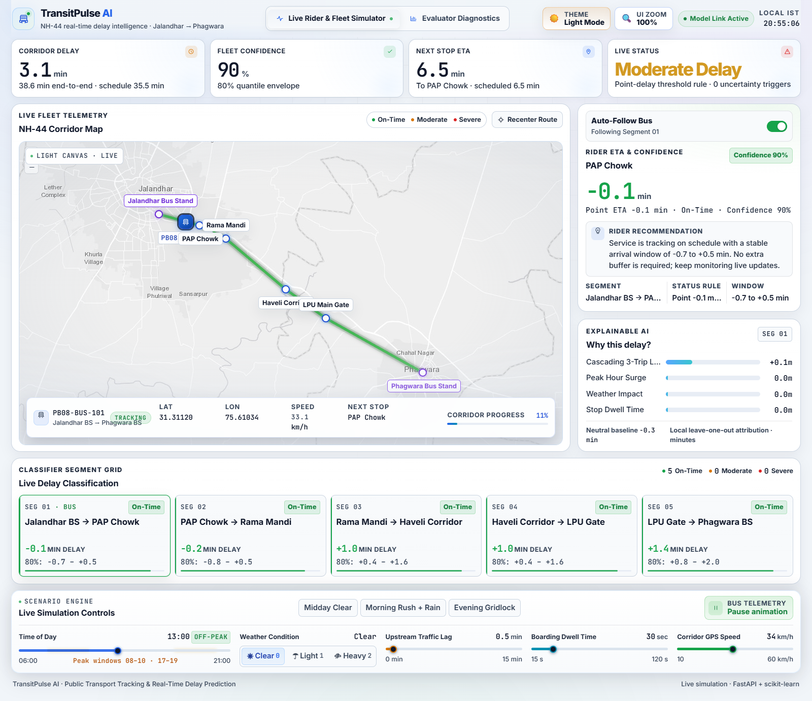
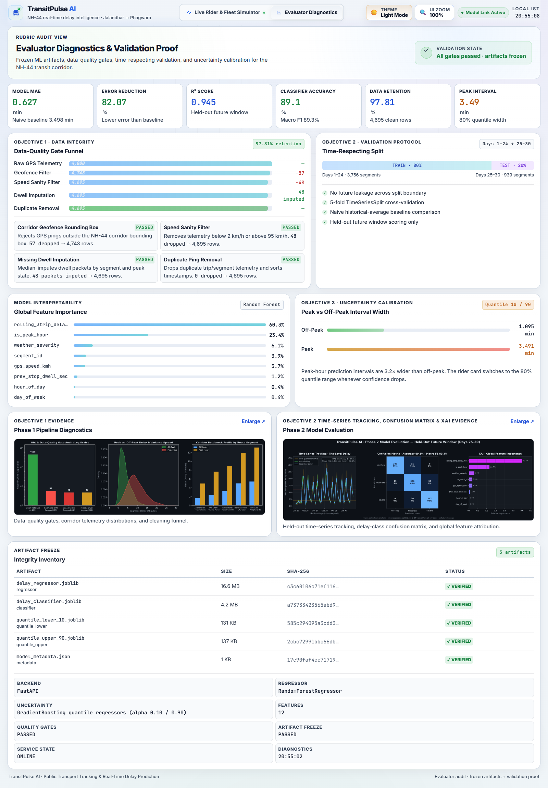

# TransitPulse AI · SIH25013

Real-time public transport tracking and delay prediction for the NH-44 corridor between Jalandhar and Phagwara. TransitPulse AI combines a live Leaflet simulation, a FastAPI inference backend, and frozen scikit-learn artifacts to forecast segment delays, classify service status, and expose peak-hour uncertainty to riders and evaluators.



## Quick Start

```powershell
.\run.ps1
```

The launcher verifies the Python environment, installs missing dependencies, regenerates frozen artifacts when needed, starts FastAPI, and opens the dashboard at `http://127.0.0.1:8000`.

Useful options:

```powershell
.\run.ps1 -NoBrowser
.\run.ps1 -Port 8080
.\run.ps1 -Reload
powershell -ExecutionPolicy Bypass -File .\run.ps1
```

Evaluator view: `http://127.0.0.1:8000/?view=evaluator`

Manual launch:

```powershell
venv\Scripts\python.exe -m pip install -r requirements.txt
venv\Scripts\python.exe src\export_artifacts.py
venv\Scripts\python.exe -m uvicorn --app-dir src app:app --host 127.0.0.1 --port 8000
```

## What The App Does

- **Live Rider & Fleet Simulator** draws the six NH-44 stops and five route segments, animates bus `PB08-BUS-101`, and updates a sleek telemetry HUD overlaid on the bottom of the map with latitude, longitude, simulated speed, next stop, and corridor progress.
- **Simulation controls** cover time of day (`06:00–21:00`), weather severity (`Clear`, `Light Rain/Fog`, `Heavy Downpour`), upstream three-trip traffic lag (`0–15 min`), boarding dwell (`15–120 s`), and corridor GPS speed. Presets load `Midday Clear`, `Morning Rush + Rain`, and `Evening Gridlock` scenarios.
- **Real model inference** runs for every segment on each control change using the Random Forest regressor, Random Forest classifier, and 10th/90th percentile quantile regressors.
- **Objective 3 uncertainty UX** computes confidence from the quantile interval width. Peak hours force the low-confidence state, show the pulsing `PEAK TRAFFIC VOLATILITY` banner, and replace the point ETA with an explicit 80% prediction range plus rider guidance.
- **Explainable AI** renders local minute-by-minute attributions for cascading three-trip lag, peak-hour surge, weather, and stop dwell time.
- **Evaluator Diagnostics** exposes the data-quality funnel, time-respecting validation metrics, feature importance, uncertainty calibration, artifact SHA-256 inventory, runtime status, and both the Phase 1 pipeline diagnostics and Phase 2 model evaluation plots. Either plot opens in a lightbox for presentation review.

## Dashboard Controls

- **Theme toggle** switches between `☀️ Light Mode` and `🌙 Dark Mode`. Light mode is the default and uses `#f1f5f9` page background, white surfaces, `#0f172a` primary text, `#334155` secondary text, and `#cbd5e1` borders. The choice is stored in `localStorage` and applied before first paint.
- **UI zoom toggle** switches the root `html` font size between `16px` (`100%`) and `18.5px` (`115%`). The preference is also persisted, so projector-friendly text survives reloads.
- **Auto-Follow Bus** is enabled by default. The right inspector tracks the bus as it moves through segments 1 → 5. Clicking a segment manually overrides the inspector until the bus enters the next segment, when auto-follow re-syncs.
- **Recenter Route** restores the full corridor with `fitBounds(corridorBounds, { padding: [45, 45], maxZoom: 13 })`. Permanent stop tooltips alternate above and below the route for readability.
- **Map basemap** follows the active theme: CARTO DarkMatter/Positron when a key is available, otherwise the keyless ESRI Dark/Light Canvas fallback.



## API

| Method | Endpoint | Description |
| --- | --- | --- |
| `GET` | `/api/health` | Service and model load state |
| `GET` | `/api/corridor` | Six stops, five segments, distances, scheduled times, peak windows |
| `POST` | `/api/simulate` | Runs live inference across all five segments |
| `GET` | `/api/diagnostics` | Model metadata, data-quality audit, verification, plots, runtime |
| `GET` | `/` | Static dashboard from `web/` |
| `GET` | `/assets/*` | Diagnostic assets from `assets/` |

Example simulation request:

```json
{
  "hour_of_day": 8,
  "is_weekend": false,
  "weather_severity": 1,
  "rolling_3trip_delay_min": 6.5,
  "prev_stop_dwell_sec": 85,
  "gps_speed_kmh": 20
}
```

Each segment response includes `predicted_delay_min`, `lower_bound_min`, `upper_bound_min`, `delay_status`, `is_peak_hour`, `confidence_pct`, `is_low_confidence`, `rider_recommendation`, `xai_drivers`, classifier diagnostics (`classifier_status`, `classifier_probability_pct`, `classifier_agrees`), simulated speed, and cumulative corridor timing. The response also carries `status_rule` so clients can display the exact public status thresholds.

Prediction intervals are centered on the published point delay:

```text
half_spread = max(0.6, (raw_upper - raw_lower) / 2.0) * (1.35 if is_peak_hour else 1.0)
lower_bound_min = round(max(-1.0, predicted_delay_min - half_spread), 1)
upper_bound_min = round(predicted_delay_min + half_spread, 1)
```

Public `delay_status` is derived strictly from the point delay: `< 2.0 min` is **On-Time**, `2.0–6.0 min` is **Moderate Delay**, and `> 6.0 min` is **Severe Delay**. The classifier remains available as diagnostic metadata but does not override these thresholds. Rider recommendations never claim `Board now` or `On-time service` when confidence is low or the status is not On-Time; they instead give a realistic delay/weather buffer and ask the rider to recheck the live ETA.

## Model Evidence

| Metric | Value |
| --- | --- |
| Held-out MAE | `0.627 min` |
| Held-out RMSE | `0.914 min` |
| Held-out R² | `0.945` |
| Naive baseline MAE | `3.498 min` |
| Error reduction | `82.07%` |
| Classifier accuracy | `89.1%` |
| Classifier macro F1 | `89.3%` |
| Off-peak interval width | `1.095 min` |
| Peak interval width | `3.491 min` |

Validation uses a time-respecting split: days 1–24 for training and days 25–30 as the untouched future test window. Five-fold `TimeSeriesSplit` cross-validation is used inside the training window. Artifacts are frozen in `models/` and verified with schema, class, finite-inference, and SHA-256 checks.

## Data-Quality Gates

| Gate | Result |
| --- | --- |
| Raw GPS telemetry | `4,800` rows |
| Corridor geofence | `57` dropped → `4,743` |
| Speed sanity filter | `48` dropped → `4,695` |
| Missing dwell packets | `48` median-imputed |
| Duplicate ping removal | `0` dropped |
| Final clean dataset | `4,695` rows · `97.81%` retention |

The full audit is written to `models/dq_audit_report.json` by `src/export_artifacts.py`.

## ML Artifacts

| Artifact | Role |
| --- | --- |
| `models/delay_regressor.joblib` | Random Forest point delay prediction |
| `models/delay_classifier.joblib` | On-Time / Moderate / Severe classifier |
| `models/quantile_lower_10.joblib` | 10th percentile uncertainty bound |
| `models/quantile_upper_90.joblib` | 90th percentile uncertainty bound |
| `models/model_metadata.json` | Metrics, uncertainty widths, feature importance |
| `models/dq_audit_report.json` | Quality gates, artifact inventory, verification |

Feature schema: `hour_of_day`, `day_of_week`, `is_weekend`, `is_peak_hour`, `segment_id`, `segment_distance_km`, `scheduled_time_min`, `historical_segment_avg_min`, `rolling_3trip_delay_min`, `prev_stop_dwell_sec`, `weather_severity`, `gps_speed_kmh`.

## Basemap Note

The map swaps tiles with the theme. Light mode requests CARTO Positron and dark mode requests CARTO DarkMatter when a browser key is supplied through `?carto_key=...` or `window.TRANSITPULSE_CARTO_KEY`. CARTO now requires a key for its basemaps, so by default the dashboard falls back to the keyless ESRI Light Canvas and Dark Canvas basemaps. This keeps the command center fully functional without paid map credentials while preserving the light/dark visual language.

## Project Structure

```text
transit-delay-predictor/
├── assets/                      Diagnostic plot and dashboard captures
├── data/
│   ├── raw/                     Raw GPS telemetry
│   └── processed/               Clean model-ready dataset
├── models/                      Frozen joblib artifacts and audit reports
├── notebooks/                   Phase 1 pipeline and Phase 2 training notebooks
├── src/
│   ├── app.py                   FastAPI backend, interval math, inference, status rules
│   └── export_artifacts.py      Artifact verification, audit generation, Phase 2 plot
├── web/
│   ├── index.html               Light/dark command-center layout and lightbox markup
│   ├── styles.css               Theme tokens, responsive styling, 100%/115% zoom
│   └── app.js                   Leaflet map, theme/tiles, auto-follow, XAI, evaluator UI
├── requirements.txt
├── run.ps1                      One-command launcher
└── TASKS.md                     Build checklist
```

## Verification

With the server running, verify all endpoints:

```powershell
Invoke-RestMethod http://127.0.0.1:8000/api/health
Invoke-RestMethod http://127.0.0.1:8000/api/corridor
Invoke-RestMethod http://127.0.0.1:8000/api/diagnostics

$body = @{
  hour_of_day = 8
  is_weekend = $false
  weather_severity = 1
  rolling_3trip_delay_min = 6.5
  prev_stop_dwell_sec = 85
  gps_speed_kmh = 20
} | ConvertTo-Json

Invoke-RestMethod -Method Post -Uri http://127.0.0.1:8000/api/simulate -ContentType "application/json" -Body $body
```

Regenerate and verify ML artifacts at any time:

```powershell
venv\Scripts\python.exe src\export_artifacts.py
```

This command also regenerates `assets/phase2_model_evaluation.png` from the frozen models and held-out test window. The plot tracks predictions over time, renders the delay-class confusion matrix, and ranks global feature importance. The Phase 1 plot is produced by `notebooks/01_phase1_data_pipeline.ipynb` and saved to `assets/phase1_pipeline_diagnostics.png`.

Frontend behavior was verified with Playwright against Chrome at `http://127.0.0.1:8000`:

- Light/dark theme toggle, `localStorage` persistence, and theme-matched tile layers
- `100%` / `115%` UI zoom and persisted root font size
- 440 px inspector, in-map telemetry overlay, and text `Recenter Route` control
- Alternating permanent stop tooltips and `fitBounds` corridor framing
- Auto-follow across segments, manual override, and re-sync on the next segment
- Both evaluator plots loading and opening/closing their lightboxes
- Responsive layouts at `1920×1080`, `1366×768 @ 115%`, `1024×768`, and `390×844` with no horizontal overflow
